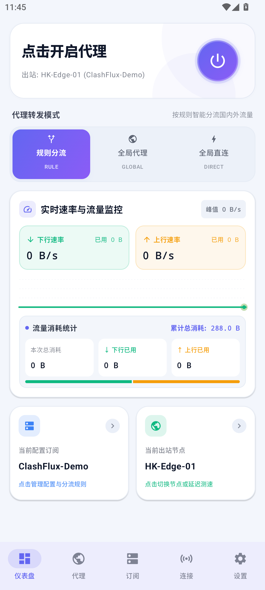
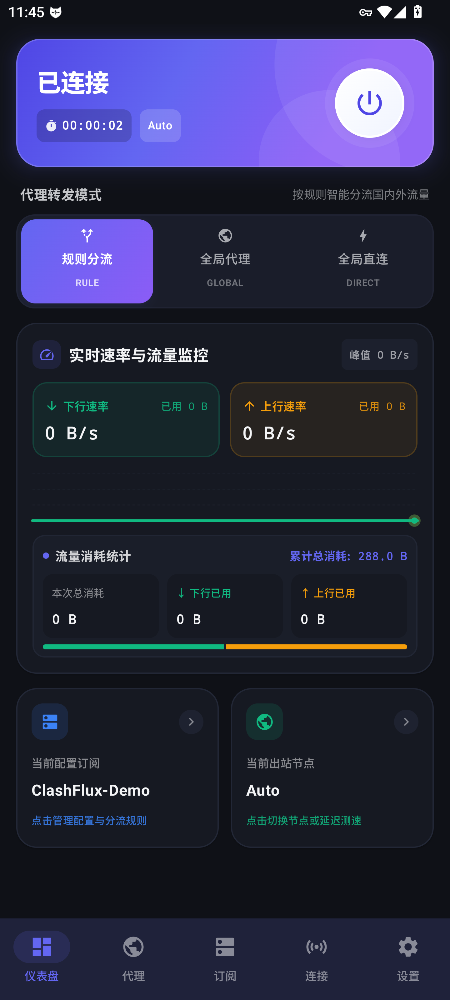
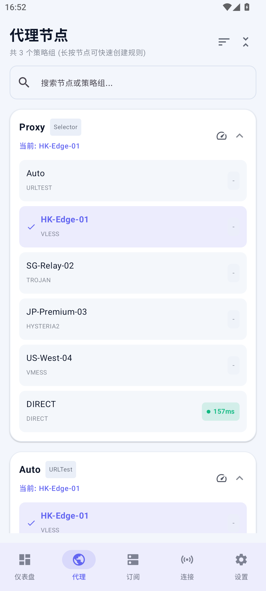
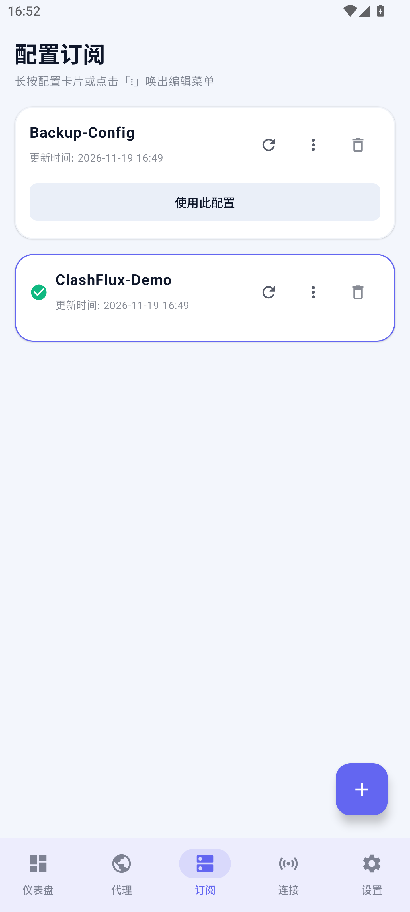
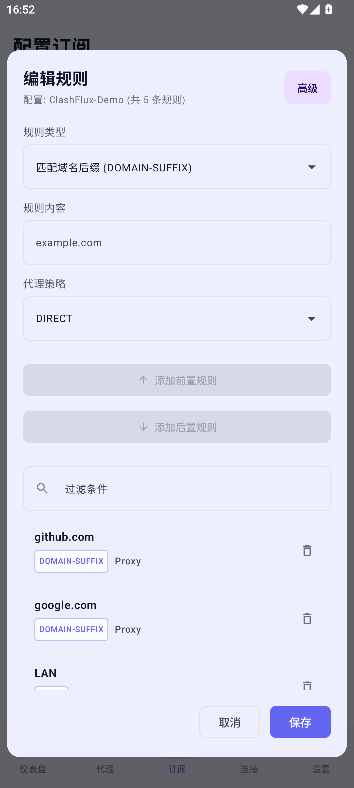
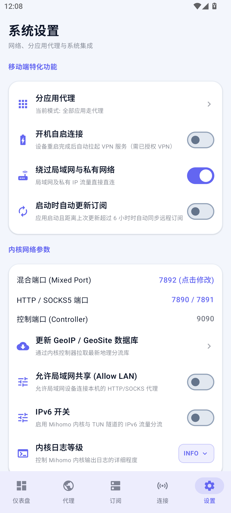

# ClashFlux

基于 **Mihomo (Clash.Meta)** 原生内核与 **Jetpack Compose (Material 3)** 构建的轻量、独立 Android 代理客户端。

---

## ✨ 功能特性

- **原生 TUN 隧道接管**
  - 基于 Android `VpnService` 与 Mihomo `gVisor` TUN 协议栈，支持 **规则分流 (Rule)**、**全局代理 (Global)**、**全局直连 (Direct)** 一键切换。
  - 支持 **IPv6 双栈**、**绕过局域网与私有网络**、**Allow LAN** 局域网共享及端口自定义（Mixed / HTTP / SOCKS5）。
- **多种导入方式与订阅管理**
  - 支持远程订阅链接（自动兼容标准 YAML 与 Base64 节点列表）、剪贴板批量导入、本地 `.yaml` 文件导入与 SAF 文档导出。
  - 原生 URI 解析支持 **VLESS (含 Reality)**、**VMess**、**Trojan**、**Shadowsocks (SIP002)**、**Hysteria2**、**TUIC**、**WireGuard** 与 **SOCKS5**。
  - 内置启动自动更新过期远程订阅、单配置修改前自动备份及一键回滚恢复。
- **内置图形化编辑能力**
  - **规则编辑器**：可视化管理前置/后置分流规则、规则检索过滤，并支持在节点列表长按节点快捷生成分流规则。
  - **节点编辑器**：表单化新增或修改多协议节点参数，亦支持直接编辑原始 YAML 配置文件。
- **移动端系统集成与监控**
  - **分应用代理**：支持「全部应用走代理」「黑名单直连」「白名单代理」，内置应用搜索与变更后快速重连提示。
  - **系统快捷磁贴 & 开机自启**：支持下拉快捷设置磁贴（`Quick Settings Tile`）一键启停及设备开机后自动拉起（需已授予 VPN 权限）。
  - **实时遥测监控**：首页提供实时上下行速率波形图与累计流量统计；连接页支持查看、搜索与手动关闭活动连接及内核实时日志。

---

## 📱 界面预览

<table>
  <tr>
    <td align="center"><b>仪表盘（浅色主题）</b></td>
    <td align="center"><b>仪表盘（深色主题）</b></td>
    <td align="center"><b>策略组与代理节点</b></td>
  </tr>
  <tr>
    <td align="center"></td>
    <td align="center"></td>
    <td align="center"></td>
  </tr>
  <tr>
    <td align="center"><b>配置与订阅管理</b></td>
    <td align="center"><b>图形化规则编辑器</b></td>
    <td align="center"><b>系统设置与分应用控制</b></td>
  </tr>
  <tr>
    <td align="center"></td>
    <td align="center"></td>
    <td align="center"></td>
  </tr>
</table>

---

## 🛠️ 技术栈与环境要求

- **语言与 UI**：Kotlin 2.3 · Jetpack Compose (Material 3) · Coroutines & StateFlow
- **网络与配置**：OkHttp 4 · SnakeYAML · kotlinx.serialization · Jetpack DataStore
- **内核与桥接**：Mihomo Native Core (`libclash.so` / `libbridge.so`，`com.github.kr328.clash.core.bridge`)，内置 `geoip.metadb` 与 `geosite.dat`
- **系统支持**：Android 8.0+（`minSdk = 26`，`targetSdk = 36`，当前 ABI 仅打包 `arm64-v8a`）
- **构建环境**：JDK 21 · Android SDK 36 · Gradle 9.1（AGP 9.0.1）

---

## 🚀 本地构建与测试

1. 克隆仓库并准备 Android SDK（可通过 `ANDROID_HOME` 或根目录 `local.properties` 配置 `sdk.dir`）与 **JDK 21**（配置 `JAVA_HOME` 或 `JAVA21_HOME` 指向 JDK 21 路径）。
2. 运行单元测试与 Lint 检查：

```bash
# Windows (PowerShell / CMD)
.\gradlew.bat testDebugUnitTest lintDebug

# Linux / macOS
./gradlew testDebugUnitTest lintDebug
```

3. 构建 Release 安装包：

```bash
# Windows
.\gradlew.bat assembleRelease

# Linux / macOS
./gradlew assembleRelease
```

生成的安装包位于：`app/build/outputs/apk/release/ClashFlux-Android-v1.0.0-release.apk`。

### 正式签名配置（可选）

若需使用正式证书签名 Release 包，可在工程根目录创建 `keystore.properties`（已被 `.gitignore` 忽略，请勿提交到版本库），或通过环境变量传入：

```properties
storeFile=path/to/your.jks
storePassword=your_store_password
keyAlias=your_key_alias
keyPassword=your_key_password
```

对应环境变量名称：`RELEASE_STORE_FILE`、`RELEASE_STORE_PASSWORD`、`RELEASE_KEY_ALIAS`、`RELEASE_KEY_PASSWORD`。未配置时默认回退使用 Debug 签名。

---

## 📂 工程结构

```text
app/src/main/
├── assets/                          # 内置 GeoIP / GeoSite 数据库
├── jniLibs/arm64-v8a/               # Mihomo 原生内核与 JNI 桥接库
└── java/
    ├── com/clashflux/android/
    │   ├── core/                    # VpnService、TileService、内核管理、控制器客户端、URI 解析、YAML 编辑器与路由计算
    │   ├── data/                    # 订阅配置仓储与 DataStore 设置仓储
    │   ├── model/                   # 配置、节点、规则、连接与流量数据模型
    │   ├── theme/                   # Material 3 浅色/深色主题与色板
    │   └── ui/                      # Compose 页面（仪表盘、代理、订阅、连接日志、系统设置与分应用代理）
    └── com/github/kr328/clash/core/bridge/  # 原生 libbridge.so JNI 接口定义
```

---

## 🙏 致谢

- [Mihomo (Clash.Meta)](https://github.com/MetaCubeX/mihomo) — 提供底层高性能代理内核与规则引擎
- [ClashMetaForAndroid](https://github.com/MetaCubeX/ClashMetaForAndroid) / [kr328](https://github.com/Kr328) — Android 端 Core JNI Bridge 设计参考

> 本项目仅供学习交流与网络研究使用，请严格遵守所在地法律法规。
